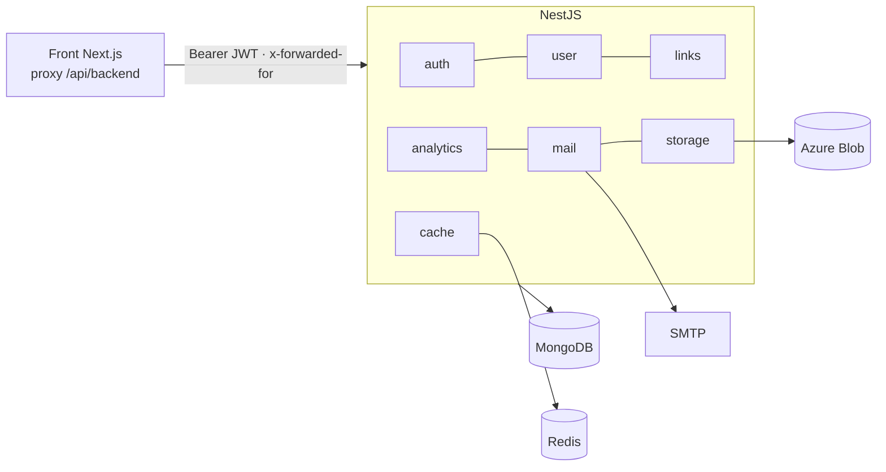
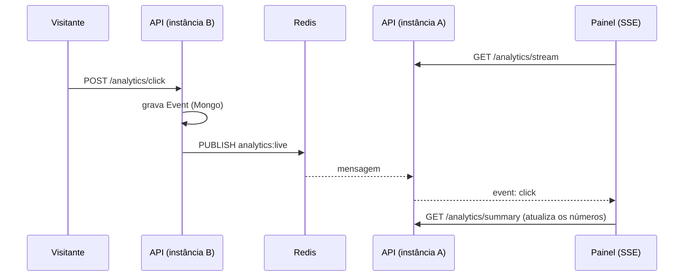

# FaceLink — API

API do agregador de links (estilo Linktree): contas, perfil público por `@usuario`, links de 10 tipos, upload de
imagens, analytics com **tempo real (SSE)**, confirmação de e-mail e recuperação de senha.

Este repositório é o **backend** (NestJS). O front fica em
[Agregador_Link_Front](https://github.com/isaqu33/Agregador_Link_Front) (veja lá as capturas de tela do produto).

**Stack:** NestJS 8 · TypeScript · MongoDB (Mongoose) · Redis (ioredis) · JWT · Azure Blob Storage (Azurite em dev) ·
nodemailer · Helmet · `@nestjs/throttler` · Jest.

## Arquitetura



| Módulo | Responsabilidade |
|---|---|
| `auth` | cadastro, login, confirmação de e-mail, recuperação de senha (tokens de uso único) |
| `jwt` | emissão e validação do JWT (estratégia passport, só `Authorization: Bearer`) |
| `user` | perfil, `username` único, redes sociais, template de aparência |
| `links` | CRUD, ordenação, página pública (por id ou `@username`) |
| `analytics` | registro de visitas/cliques, resumo por período e **stream SSE** |
| `cache` | contadores com expiração e pub/sub: **Redis** (`REDIS_URL`) ou memória |
| `mail` | e-mails (nodemailer); sem SMTP, imprime o e-mail no log |
| `storage` | upload e leitura de imagens no Azure Blob |
| `common` | regras de link/usuário (`link-rules.ts`), guard de rate limit, `toJSON` |

## Endpoints

| Rota | Auth | Descrição |
|---|---|---|
| `POST /auth/register` | — | `{name,email,password}`; 409 se o e-mail existe; manda e-mail de confirmação |
| `POST /auth/login` | — | `{email,password}` → `{accessToken,user}`; 401 genérico |
| `POST /auth/forgot-password` | — | `{email}`; **sempre 200** (não revela se o e-mail existe) |
| `POST /auth/reset-password` | — | `{token,password}`; token de uso único, vale 1 h |
| `POST /auth/verify-email` | — | `{token}` |
| `POST /auth/resend-verification` | JWT | reenvia a confirmação |
| `GET /user/me` | JWT | perfil + links (sem senha nem tokens) |
| `POST /user/editProfile` | JWT | `name, photoURL, template, title, about, username, socials` |
| `POST /links/addLink` | JWT | `{name, link?, type}`; validação por tipo |
| `POST /links/editLink` | JWT | `{id, name?, link?}`; só do dono |
| `POST /links/deletLink` | JWT | `{idlink}` |
| `POST /links/editActivet` | JWT | `{id, activation}` |
| `POST /links/reorder` | JWT | `{ids:[...]}` na nova ordem |
| `GET /links/getDataUser/:id` | — | página pública; `:id` é o id **ou** o `@username` |
| `POST /analytics/view` · `/click` | — | registra visita / clique (sempre 200) |
| `GET /analytics/summary?days=30` | JWT | totais, taxa, série por dia, cliques por link |
| `GET /analytics/stream` | JWT | **SSE** com os eventos `view` e `click` da página do usuário |
| `POST /media` · `GET /media/:userId/:file` | JWT / — | upload (JPEG/PNG/WebP/GIF até 5 MB) e leitura |

Tipos de link aceitos (`type`): `Link, Spotify, Youtube, Whatsapp, Twitch, Email, Instagram, Tiktok, Telefone,
Cabecalho`. O `link` é validado **pelo tipo**: `http(s)` (padrão), `mailto:` (Email), `tel:+…` (Telefone), vazio
(Cabecalho). `javascript:` e `data:` nunca passam.

> `deletLink`, `editActivet` e `isActivit` têm erro de digitação histórico, mas são contrato com o front.

## Segurança

- **Helmet** com `Cross-Origin-Resource-Policy: cross-origin` (o front lê `/media`).
- **Rate limit por IP e por rota** (429 + `Retry-After`): login 10/min, cadastro 5/min, esqueci a senha 3/min,
  redefinir 5/min, confirmar e-mail 10/min, reenvio 3/min, visitas/cliques 60/min, demais rotas 120/min.
- **Bloqueio por conta:** 5 senhas erradas para o mesmo e-mail em 15 min bloqueiam novas tentativas (429), mesmo
  trocando de IP. Um login correto zera a contagem.
- **Sem enumeração de contas:** login responde o mesmo 401 para senha errada e e-mail inexistente (comparando contra
  um hash falso para custar o mesmo tempo); `forgot-password` sempre responde 200.
- **Senhas** com bcrypt (custo 12), `select:false` no schema. **Tokens** de e-mail e de redefinição de senha são
  aleatórios (32 bytes) e só o **hash SHA-256** fica no banco; uso único e com validade.
- **Dono de cada recurso:** link de outro usuário responde 404 (não 403), então os ids não podem ser sondados.
- **Validação rígida** (`whitelist` + `forbidNonWhitelisted`): campo extra no corpo vira 400.
- **Nomes de usuário** reservados (`login`, `costumer`, `api`, `u`…) para não colidirem com rotas do front.
- `.env` não é versionado.

## Analytics em tempo real



Com `REDIS_URL`, qualquer instância entrega o evento registrado por outra; o anti-duplicidade (mesmo visitante e alvo
em 3 s conta uma vez) e os contadores de rate limit também são compartilhados. Sem Redis tudo funciona em memória
(uma instância). A conexão SSE recebe um `ping` a cada 25 s para não ser derrubada por proxies.

## Modelo de dados (MongoDB, banco `agregador`)

- **User:** `name`, `email` (único), `password` (hash), `photoURL`, `template` (JSON: cor, formato, fonte, botão),
  `title`, `about`, `username` (único, opcional), `socials[{network,url}]`, `emailVerified`, hashes de token.
- **Link:** `name`, `link`, `type`, `order`, `isActivit`, `userId`.
- **Event:** `userId`, `type` (`view`|`click`), `linkId?`, `createdAt` (índice por `userId` + data).

## Rodando (desenvolvimento)

Requisitos: Docker e Docker Compose (ou Node 20 fora do Docker).

```bash
cp .env.example .env            # defina SECRET_JWT (openssl rand -hex 32) e as credenciais SEED_USER_*
docker compose -f docker-compose.dev.yml up -d --build -V
docker compose -f docker-compose.dev.yml exec api npm run seed   # cria o primeiro usuário
```

Suba a API **antes** do front: ela cria a rede `agregador-network` que o front usa.

| Serviço | URL / porta |
|---|---|
| API | http://localhost:3070 |
| MongoDB | localhost:27070 |
| Azurite (blob) | localhost:10070 |
| Redis | só na rede do Docker (`redis-agregador:6379`) |

### Variáveis de ambiente (`.env.example`)

| Variável | Para quê |
|---|---|
| `SECRET_JWT` | assinatura do JWT |
| `DATABASE_URL`, `MONGO_*` | conexão com o MongoDB |
| `CORS_ORIGINS` | origens permitidas (padrão `http://localhost:3071`) |
| `REDIS_URL` | opcional; estado compartilhado entre instâncias |
| `APP_URL` | base dos links dos e-mails (URL do front) |
| `SMTP_HOST`, `SMTP_PORT`, `SMTP_USER`, `SMTP_PASS`, `MAIL_FROM` | envio de e-mail; **sem `SMTP_HOST` o e-mail vai para o log** |
| `SEED_USER_*` | usuário criado por `npm run seed` (já nasce com e-mail confirmado) |
| `API_PORT_HOST`, `MONGO_PORT_HOST`, `AZURITE_BLOB_PORT_HOST` | portas no host |

## Testes

```bash
npm test            # 89 testes em 8 suítes, sem precisar de banco
npx tsc --noEmit
```

| Suíte | O que garante |
|---|---|
| `auth.service` | hash de senha, tokens de uso único (só o hash é guardado), 401 genérico, bloqueio por conta, não enumera e-mails |
| `links.service` | validação por tipo (rejeita `javascript:`/`data:`), 404 para link de outro usuário, reordenação, página pública sem dados privados |
| `user.service` | usernames reservados e duplicados (409), validação das redes sociais |
| `analytics.service` | contagem, anti-duplicidade, série por dia, isolamento por usuário, **entrega entre duas instâncias** |
| `cache.service` | contadores com expiração, pub/sub |
| `link-rules` | regras de URL, username e redes |
| `http-security` | controller + guard + validação reais: Helmet, 429 com `Retry-After`, limite por IP/rota, 400 de validação |

Os models do Mongoose são simulados (`src/test-utils.ts`). Foi verificado que os testes falham quando as regras são
quebradas de propósito (bloqueio de login, checagem de dono, anti-duplicidade). Ainda **não há teste de integração
contra um MongoDB real**.

## Estrutura

```
src/
  auth/ jwt/ user/ links/ analytics/ mail/ storage/ cache/ common/
  main.ts                 Helmet, CORS, ValidationPipe
  app.module.ts           módulos + guard global de rate limit
  seed.ts                 primeiro usuário
  *.spec.ts               testes ao lado do código
```

## Limitações conhecidas

- Sem SMTP o e-mail só aparece no log (suficiente em dev; configure `SMTP_*` para produção).
- O limite por IP usa `x-forwarded-for`: em produção, o proxy reverso na frente da API **precisa sobrescrever** esse
  cabeçalho, senão o cliente poderia forjá-lo (o bloqueio por conta continua valendo).
- Sem testes de integração com banco real; sem CI configurado.

## Atenção antes de tornar o repositório público

O histórico antigo deste repositório contém uma **chave do Firebase** e um `.env` antigos. **Revogue a chave** e limpe o
histórico (ou publique a partir de um repositório novo) antes de abrir o código; enquanto isso, mantenha-o privado.
