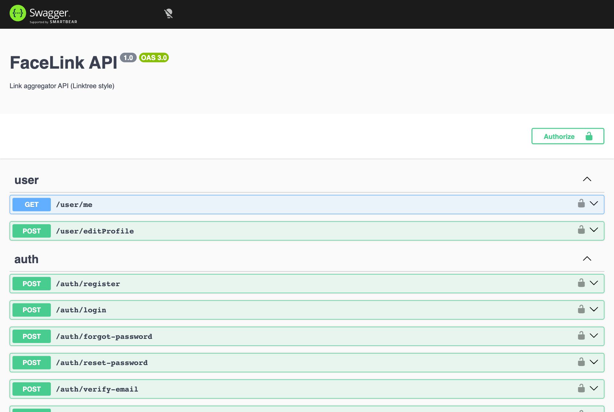
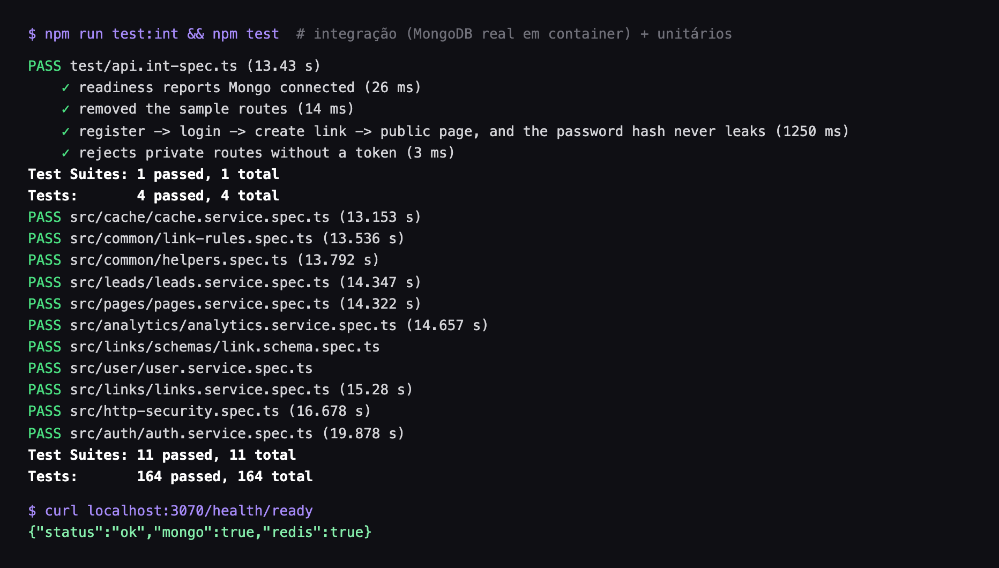
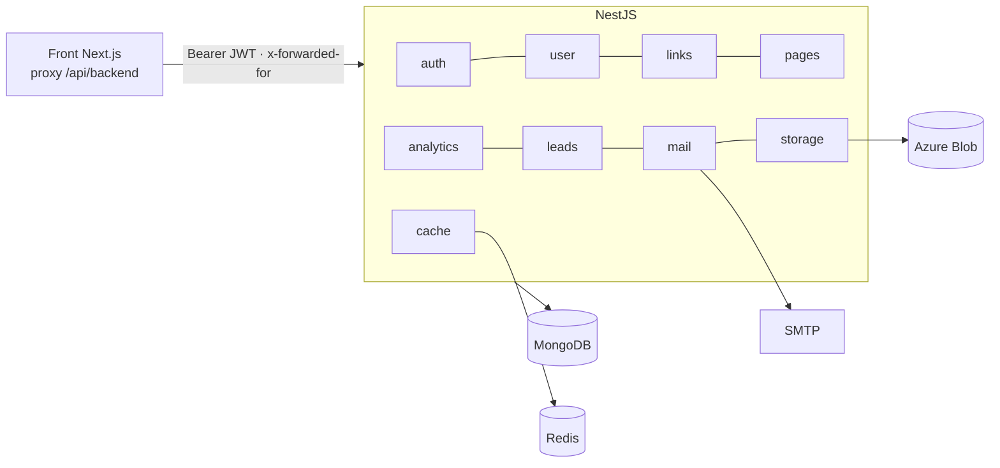
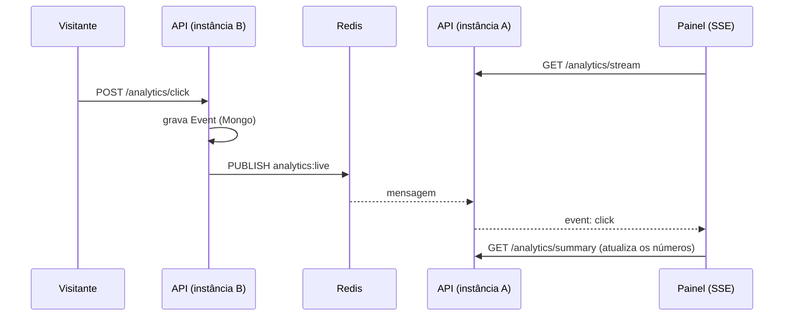

<p align="center"></p>

<h3 align="center">API do agregador de links (estilo Linktree): segura, testada e observável</h3>

<p align="center">
  
  
  
  
  
  
  
</p>

Contas, perfil público por `@usuario`, **várias páginas por conta**, links de 12 tipos (miniatura, destaque, agendamento,
player e senha), captura de e-mail, upload de imagens, analytics com **tempo real (SSE) que funciona com várias
instâncias**, exportação CSV, confirmação de e-mail, recuperação de senha e login com Google.

Este repositório é o **backend** (NestJS). O front fica em
[Agregador_Link_Front](https://github.com/isaqu33/Agregador_Link_Front) (veja lá as capturas de tela do produto).

| Documentação interativa (Swagger em `/docs`) | Testes de integração e unitários |
|---|---|
|  |  |

## O que este projeto demonstra

| Área | O que foi aplicado |
|---|---|
| **Segurança** (OWASP API Top 10, 2023) | autorização por dono (404 em vez de 403), rate limit por IP/rota e bloqueio por conta, bcrypt, tokens de uso único só com hash, validação rígida (`whitelist`), Helmet, CORS restrito, limite de corpo, anti-enumeração de contas, honeypot, CSV sem injeção de fórmula |
| **Testes** | 195 unitários (Jest) + testes HTTP (Supertest) + **integração contra MongoDB e Redis reais** (Testcontainers), incluindo **testes que reproduzem condições de corrida** |
| **Concorrência** | contadores atômicos (Lua no Redis, `$inc` no Mongo), reserva de `@username` por chave única, rate limit exato sob rajada, lista desatualizada recusada (409), paginação por cursor, TTL nos eventos: cada correção tem um teste de corrida |
| **Escalabilidade** | estado compartilhado em Redis (rate limit, anti-duplicidade e pub/sub do SSE): um clique registrado na instância B chega ao painel conectado na A; sem Redis cai para memória |
| **Observabilidade** | logs JSON (Pino) com `x-request-id`, segredos redigidos, `/health/live` e `/health/ready`, encerramento gracioso |
| **Contrato** | OpenAPI/Swagger gerado do código (`/docs`), DTOs validados com `class-validator` |
| **Qualidade e CI** | Prettier + ESLint + `tsc` + GitHub Actions (formatação, lint, tipos, testes, build, integração) + Dependabot |
| **Arquitetura** | módulos por domínio, controllers finos, regras puras e testáveis (`common/`), OAuth servidor-a-servidor com segredo compartilhado |
| **Operação** | Docker Compose (API, MongoDB, Redis, Azurite), 12-factor (`.env.example`), seed do primeiro usuário |

## Arquitetura



| Módulo | Responsabilidade |
|---|---|
| `auth` | cadastro, login, confirmação de e-mail, recuperação de senha (tokens de uso único) |
| `jwt` | emissão e validação do JWT (estratégia passport, só `Authorization: Bearer`) |
| `user` | perfil, `username` único, redes sociais, template de aparência |
| `links` | CRUD, ordenação, extras (miniatura, destaque, agendamento, player, senha), `unlock`, página pública |
| `pages` | páginas extras da conta (a principal é o próprio usuário) |
| `leads` | e-mails coletados pelos formulários públicos; lista, remoção e CSV |
| `analytics` | visitas/cliques (dispositivo, origem), resumo por período, **stream SSE** e exportação CSV |
| `cache` | contadores com expiração e pub/sub: **Redis** (`REDIS_URL`) ou memória |
| `mail` | e-mails (nodemailer); sem SMTP, imprime o e-mail no log |
| `storage` | upload e leitura de imagens no Azure Blob |
| `common` | regras de link/usuário (`link-rules.ts`), guard de rate limit, `toJSON` |

## Endpoints

| Rota | Auth | Descrição |
|---|---|---|
| `POST /auth/register` | — | `{name,email,password}`; 409 se o e-mail existe; manda e-mail de confirmação |
| `POST /auth/login` | — | `{email,password}` → `{accessToken,user}`; 401 genérico |
| `POST /auth/forgot-password` | — | `{email}`; **sempre 200** (não revela se o e-mail existe) |
| `POST /auth/reset-password` | — | `{token,password}`; token de uso único, vale 1 h |
| `POST /auth/verify-email` | — | `{token}` |
| `POST /auth/resend-verification` | JWT | reenvia a confirmação |
| `GET /user/me` | JWT | perfil + links (sem senha nem tokens) |
| `POST /user/editProfile` | JWT | `name, photoURL, template, title, about, username, socials` |
| `POST /links/addLink` | JWT | `{name, link?, type, pageId?}` + extras (`thumbnail, featured, startAt, endAt, embed, password`); validação por tipo |
| `POST /links/unlock` | — | `{linkId, password}` → destino de um link com senha |
| `POST /links/editLink` | JWT | `{id, name?, link?}`; só do dono |
| `POST /links/deletLink` | JWT | `{idlink}` |
| `POST /links/editActivet` | JWT | `{id, activation}` |
| `POST /links/reorder` | JWT | `{ids:[...]}` na nova ordem (lista inteira da página; desatualizada → 409) |
| `GET /links/getDataUser/:id` | — | página pública (usuário ou página extra); `:id` é o id **ou** o `@username`; só links ativos e dentro do agendamento; links com senha vêm sem destino |
| `POST /pages/create` · `/edit` · `/delete` · `GET /pages/:id` | JWT | páginas extras (máx. 5) |
| `POST /leads` | — | e-mail do formulário público (sempre 200; honeypot e limite) |
| `GET /leads?limit=&cursor=` · `/leads/export` · `POST /leads/delete` | JWT | contatos: lista paginada por cursor, CSV, remoção |
| `POST /auth/oauth` | segredo | servidor → servidor: login com Google |
| `POST /analytics/view` · `/click` | — | registra visita (com dispositivo e origem) / clique (sempre 200) |
| `GET /analytics/export` | JWT | CSV por dia ou por link |
| `GET /analytics/summary?days=30` | JWT | totais, taxa, série por dia, cliques por link |
| `GET /analytics/stream` | JWT | **SSE** com os eventos `view` e `click` da página do usuário |
| `POST /media` · `GET /media/:userId/:file` | JWT / — | upload (imagem até 5 MB ou vídeo MP4/WebM até 15 MB) e leitura com suporte a `Range` |

Tipos de link aceitos (`type`): `Link, Spotify, Youtube, Whatsapp, Twitch, Email, Instagram, Tiktok, Telefone,
Cabecalho, Pix, Newsletter`. O `link` é validado **pelo tipo**: `http(s)` (padrão), `mailto:` (Email), `tel:+…` (Telefone),
chave Pix (Pix), vazio (Cabecalho, Newsletter). `javascript:` e `data:` nunca passam. A miniatura só pode ser uma imagem
do próprio dono (`/media/<id>/…`) ou um asset do projeto; o player só é gerado para YouTube/Spotify reais.

> `deletLink`, `editActivet` e `isActivit` têm erro de digitação histórico, mas são contrato com o front.

## Segurança

- **Helmet** com `Cross-Origin-Resource-Policy: cross-origin` (o front lê `/media`).
- **Rate limit por IP e por rota** (429 + `Retry-After`): login 10/min, cadastro 5/min, esqueci a senha 3/min,
  redefinir 5/min, confirmar e-mail 10/min, reenvio 3/min, visitas/cliques 60/min, demais rotas 120/min.
- **Bloqueio por conta:** 5 senhas erradas para o mesmo e-mail em 15 min bloqueiam novas tentativas (429), mesmo
  trocando de IP. Um login correto zera a contagem.
- **Sem enumeração de contas:** login responde o mesmo 401 para senha errada e e-mail inexistente (comparando contra
  um hash falso para custar o mesmo tempo); `forgot-password` sempre responde 200.
- **Senhas** com bcrypt (custo 12), `select:false` no schema. **Tokens** de e-mail e de redefinição de senha são
  aleatórios (32 bytes) e só o **hash SHA-256** fica no banco; uso único e com validade.
- **Link com senha:** o hash (bcrypt) nunca é serializado e o destino não vai na página pública; `unlock` bloqueia o link após 5 erros em 15 min e limita 10/min por IP.
- **Formulário de e-mail:** campo-armadilha (honeypot), 5/min por IP, resposta sempre 200 (não revela formulários), um e-mail conta uma vez por formulário.
- **Exportações CSV:** células que começam com `= + - @` são neutralizadas (injeção de fórmula em planilhas).
- **Login com Google:** a API só aceita `POST /auth/oauth` com um segredo compartilhado (comparação em tempo constante), recusa e-mail não verificado e fica desligada (404) sem o segredo.
- **Dono de cada recurso:** link de outro usuário responde 404 (não 403), então os ids não podem ser sondados.
- **Validação rígida** (`whitelist` + `forbidNonWhitelisted`): campo extra no corpo vira 400.
- **Nomes de usuário** reservados (`login`, `costumer`, `api`, `u`…) para não colidirem com rotas do front.
- `.env` não é versionado.

## Analytics em tempo real



Com `REDIS_URL`, qualquer instância entrega o evento registrado por outra; o anti-duplicidade (mesmo visitante e alvo
em 3 s conta uma vez) e os contadores de rate limit também são compartilhados. Sem Redis tudo funciona em memória
(uma instância). A conexão SSE recebe um `ping` a cada 25 s para não ser derrubada por proxies.

## Modelo de dados (MongoDB, banco `agregador`)

- **Page** (página extra) e **Lead** (e-mail coletado); o **Link** ganhou `thumbnail, featured, startAt, endAt, embed, locked, passwordHash, pageId`.
- **User:** `name`, `email` (único), `password` (hash), `photoURL`, `template` (JSON validado: cor, formato, fonte, botão, cor do texto, fundo em imagem/vídeo, marca d'água),
  `title`, `about`, `username` (único, opcional), `socials[{network,url}]`, `emailVerified`, hashes de token.
- **Link:** `name`, `link`, `type`, `order`, `isActivit`, `userId`.
- **Event:** `userId`, `type` (`view`|`click`), `linkId?`, `createdAt` (índice por `userId` + data).

## Rodando (desenvolvimento)

Requisitos: Docker e Docker Compose (ou Node 20 fora do Docker).

```bash
cp .env.example .env            # defina SECRET_JWT (openssl rand -hex 32) e as credenciais SEED_USER_*
docker compose -f docker-compose.dev.yml up -d --build -V
docker compose -f docker-compose.dev.yml exec api npm run seed   # cria o primeiro usuário
```

Suba a API **antes** do front: ela cria a rede `agregador-network` que o front usa.

| Serviço | URL / porta |
|---|---|
| API | http://localhost:3070 |
| MongoDB | localhost:27070 |
| Azurite (blob) | localhost:10070 |
| Redis | só na rede do Docker (`redis-agregador:6379`) |

### Variáveis de ambiente (`.env.example`)

| Variável | Para quê |
|---|---|
| `SECRET_JWT` | assinatura do JWT |
| `DATABASE_URL`, `MONGO_*` | conexão com o MongoDB |
| `CORS_ORIGINS` | origens permitidas (padrão `http://localhost:3071`) |
| `REDIS_URL` | opcional; estado compartilhado entre instâncias |
| `APP_URL` | base dos links dos e-mails (URL do front) |
| `SMTP_HOST`, `SMTP_PORT`, `SMTP_USER`, `SMTP_PASS`, `MAIL_FROM` | envio de e-mail; **sem `SMTP_HOST` o e-mail vai para o log** |
| `OAUTH_SHARED_SECRET` | login com Google (igual ao do front); vazio = desligado |
| `SEED_USER_*` | usuário criado por `npm run seed` (já nasce com e-mail confirmado) |
| `API_PORT_HOST`, `MONGO_PORT_HOST`, `AZURITE_BLOB_PORT_HOST` | portas no host |

## Testes

```bash
npm test              # 195 testes em 15 suítes, sem precisar de banco
npm run test:int      # integração: sobe um MongoDB real em container (Testcontainers; precisa de Docker)
npm run typecheck && npm run lint:check && npm run format:check
```

| Suíte | O que garante |
|---|---|
| `auth.service` | hash de senha, tokens de uso único (só o hash é guardado), 401 genérico, bloqueio por conta, não enumera e-mails |
| `links.service` | validação por tipo (rejeita `javascript:`/`data:`), 404 para link de outro usuário, reordenação, página pública sem dados privados |
| `user.service` | usernames reservados e duplicados (409), validação das redes sociais |
| `analytics.service` | contagem, anti-duplicidade, série por dia, isolamento por usuário, **entrega entre duas instâncias** |
| `cache.service` | contadores com expiração, pub/sub |
| `link-rules` · `helpers` | regras de URL/username/redes, player (YouTube/Spotify), CSV, dispositivo e origem |
| `leads.service` · `pages.service` · `link.schema` | captura sem duplicar/honeypot, escopo por página e dono, o hash nunca é serializado |
| `http-security` | controller + guard + validação reais: Helmet, 429 com `Retry-After`, limite por IP/rota, 400 de validação |

Os models do Mongoose são simulados (`src/test-utils.ts`). Foi verificado que os testes falham quando as regras são
quebradas de propósito (bloqueio de login, checagem de dono, anti-duplicidade). O teste de integração
(`test/api.int-spec.ts`) sobe a API inteira contra um MongoDB real: readiness, cadastro → login → criar link → página
pública, validação e 401.

## Operação

- **Logs JSON** (pino) com `x-request-id` por requisição; `authorization` e `cookie` ficam fora do log. `LOG_LEVEL` ajusta o nível.
- **Health:** `GET /health/live` e `GET /health/ready` (Mongo e Redis). Encerramento gracioso em SIGTERM.
- **OpenAPI:** Swagger UI em `/docs` (desligado em produção, salvo `SWAGGER=true`).
- **CI:** GitHub Actions (formatação, lint, tipos, testes, build e integração), sem deploy.

## Estrutura

```
src/
  auth/ jwt/ user/ links/ analytics/ mail/ storage/ cache/ common/
  main.ts                 Pino, Helmet, CORS, limite de corpo, ValidationPipe, Swagger
  health/                 liveness e readiness
  app.module.ts           módulos + guard global de rate limit
  seed.ts                 primeiro usuário
  *.spec.ts               testes ao lado do código
```

## Limitações conhecidas

- Sem SMTP o e-mail só aparece no log (suficiente em dev; configure `SMTP_*` para produção).
- O limite por IP usa `x-forwarded-for`: em produção, o proxy reverso na frente da API **precisa sobrescrever** esse
  cabeçalho, senão o cliente poderia forjá-lo (o bloqueio por conta continua valendo).
- O workflow de CI foi escrito mas ainda não rodou no GitHub (nada foi enviado); cada passo foi executado localmente.
